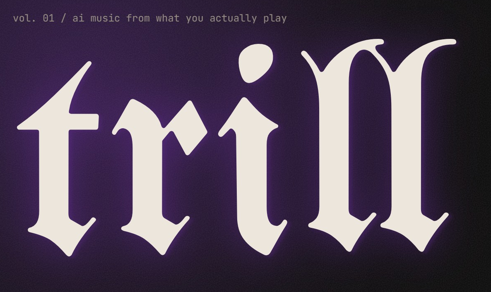

# trill



ai music from what you actually play. trill makes a song out of your rotation, then finds the shows worth pulling up to.

trill reads your top artists, maps them to eight audio dimensions and a weighted genre profile, has Claude write a production brief, and renders it with [ACE-Step 1.5](https://github.com/ace-step/ACE-Step) on your own GPU in about twenty seconds.

```
Spotify top artists ─▶ Last.fm genre tags ─▶ 8-axis taste profile
                                                      │
                               ┌──────────────────────▼──────────────────────┐
                               │  Composer                                   │
                               │  Claude (claude-opus-5-5) writes the brief: │
                               │  style caption · lyrics · BPM · key · title │
                               │  Template engine as offline fallback        │
                               └──────────────────────┬──────────────────────┘
                                                      │
                                          ACE-Step 1.5 (local GPU) ─▶ .mp3
                                                      │
                               background worker saves audio, duration, waveform
```

## What it does

**Six ways to make a track**

| Mode | What you give it | What happens |
|------|------------------|--------------|
| Taste to Track | Nothing | A track that sits in the middle of your library |
| Mood Sliders | Drag the radar or sliders | Your profile, bent toward tonight |
| Lyric Mode | Lyrics, or a theme | Claude writes lyrics in your sound if you only give a theme |
| Artist Fusion | 2 or 3 of your top artists | Their genre profiles are blended 70/30 with yours, described sonically, never by name |
| Creative Brief | A sentence or two | The brief leads, your profile sets the palette |
| Festival Lineup | Names from a scanned poster | One track for the whole bill |

Every mode accepts a preset (Late Night Drive, Gym, Deep Focus, Heartbreak, House Party, Sunrise, Rage, Lo-fi Study), a vocals toggle, a length from 15 to 240 seconds and up to three takes rendered with different seeds.

**Preview before you render.** The Studio can compose the brief without touching the GPU. You see the caption, lyrics, BPM and key, edit any of them, then render.

**Sound DNA.** Claude writes a short, specific read of your taste for the dashboard: a headline, a summary, signature sounds, eras, and suggestions for what to try next. Cached a week, rewritten when your profile rebuilds.

**A real library.** Persistent bottom player with waveform scrubbing, queue, keyboard control (space). Search across titles, captions and lyrics. Filter by mode or favorites, sort by plays, rename inline, download as MP3.

**Poster scanner.** Photograph a lineup. Tesseract reads it, Spotify resolves the names, each act is scored on name confidence, genre overlap with your profile and co-occurrence with artists you already play. Select the acts and send them to Festival mode.

## Architecture

```
frontend/  React 18 + TypeScript + Vite        :5180
backend/   Flask + SQLAlchemy (SQLite/Postgres) :8888
           ├─ routes/      auth, spotify, generate, scan
           ├─ services/    llm (Claude), caption_engine, taste, genre_analyzer,
           │               acestep_client, generation_service, worker, media
           └─ tests/       37 pytest tests, no network
ACE-Step   separate process, your GPU          :8001
```

### Security model

Every `/api/*` route requires a bearer token issued at the end of the Spotify OAuth flow. Tokens are signed with `FLASK_SECRET_KEY` and encode the Spotify user id, so a request can only ever read or change its own user's data. Audio URLs carry a separate signature bound to the generation id because `<audio>` cannot send headers. OAuth uses a signed `state` parameter. Generate and LLM endpoints are rate limited per user.

### Composer

`services/llm.py` calls Claude through the official `anthropic` SDK using structured outputs (`messages.parse` with Pydantic models), a cached system prompt, and `effort: low` for sub-two-second briefs. If no key is configured, or a call fails or is declined, `services/caption_engine.py` produces the brief from a deterministic template with genre-specific instrument palettes. The response tells the UI which engine ran.

### Taste profile

Spotify removed the audio-features API for new apps in late 2024, so trill infers the eight dimensions itself. Each top artist's genres (Spotify's, or Last.fm's when Spotify returns none) are weighted by rank and by whether the artist also appears in your last four weeks, then mapped through a database of 100-plus genre profiles with keyword modifiers for unknown tags. The weighted genre list is stored alongside the feature vector and sent to the composer.

### Background completion

A daemon thread polls ACE-Step for every active generation every three seconds and saves the audio, duration (mutagen) and a 96-bucket RMS waveform (soundfile or librosa) as soon as a task finishes. Closing the browser no longer strands a render. Status endpoints also sync on read, so the two paths never disagree.

## Setup

### Prerequisites

- Python 3.11+ and Node 18+
- An NVIDIA GPU with 8 GB+ VRAM running [ACE-Step 1.5](https://github.com/ace-step/ACE-Step) (`uv run acestep-api`, port 8001)
- A Spotify developer app with `http://127.0.0.1:8888/callback` as a redirect URI and your account added under User Management
- Optional but recommended: an Anthropic API key

### Run it

```bash
# backend
cd backend
cp ../.env.example .env        # fill in Spotify credentials, optionally ANTHROPIC_API_KEY
pip install -r requirements.txt
python app.py                  # http://127.0.0.1:8888

# frontend
cd frontend
npm install
npm run dev                    # http://localhost:5180

# tests
cd backend && python -m pytest
cd frontend && npm run typecheck
```

Open http://localhost:5180 and connect Spotify. Production lives at https://trill.ai. Without ACE-Step running you can still browse your profile and preview briefs; the GPU pill in the nav turns green when it is reachable.

### Environment variables

See `.env.example` for the full list. The ones that matter:

| Variable | Purpose |
|----------|---------|
| `SPOTIFY_CLIENT_ID`, `SPOTIFY_CLIENT_SECRET`, `SPOTIFY_REDIRECT_URI` | OAuth |
| `FLASK_SECRET_KEY` | Signs session tokens and audio links. Auto-generated for dev, required in production |
| `ANTHROPIC_API_KEY`, `ANTHROPIC_MODEL` | Enables the Claude composer and Sound DNA. Default model `claude-opus-5-5` |
| `ACESTEP_API_URL` | Where ACE-Step listens |
| `FRONTEND_URL`, `CORS_ALLOW_ORIGINS` | Redirect target after login and allowed origins |
| `DATABASE_URL` | SQLite by default; Postgres via `postgresql+psycopg://` |
| `MAX_VARIATIONS`, `MAX_DURATION_SECONDS`, `RATE_LIMIT_GENERATE` | Guardrails |

Frontend: `VITE_API_BASE` points at the backend when it is not on `127.0.0.1:8888`.

## API

All routes except `/login`, `/callback`, `/api/health/*`, `/api/generate/presets` and `/api/audio/*` require `Authorization: Bearer <token>`.

| Method | Endpoint | Description |
|--------|----------|-------------|
| `GET` | `/login` | Start Spotify OAuth (`?next=/studio` to land somewhere specific) |
| `GET` | `/callback` | OAuth return; redirects to the frontend with `#token=` |
| `GET` | `/api/me` | Profile plus capabilities (GPU online, Claude configured, limits) |
| `GET` | `/api/me/taste` | Taste profile with weighted genres and top artists |
| `POST` | `/api/me/taste/refresh` | Rebuild the profile from Spotify now |
| `GET` | `/api/me/insights` | Claude's Sound DNA narrative |
| `GET` | `/api/me/top-artists`, `/api/me/top-tracks` | Spotify data by time range |
| `GET` | `/api/me/stats` | Library totals by mode and engine |
| `GET` | `/api/generate/presets` | Preset catalog and mode list |
| `POST` | `/api/generate/preview` | Compose a brief without submitting it |
| `POST` | `/api/generate` | Compose (or use `edits`) and submit `variations` tasks; returns a batch |
| `GET` | `/api/generate/batch/:id` | Poll every take in a batch |
| `GET` | `/api/generate/status/:id` | Poll one generation |
| `GET` | `/api/generate/history` | Library with `q`, `mode`, `favorites`, `status`, `sort`, paging |
| `PATCH` / `DELETE` | `/api/generate/:id` | Rename, favorite, delete |
| `POST` | `/api/generate/:id/favorite`, `/played` | Toggle favorite, count a play |
| `POST` | `/api/compose/lyrics` | Claude writes lyrics for a theme |
| `GET` | `/api/audio/:id?t=` | Stream audio; add `&download=1` for an attachment |
| `POST` | `/api/scan` | OCR a poster image and score the acts |

The generate body:

```json
{
  "mode": "mood",
  "preset": "late_night_drive",
  "overrides": { "energy": 0.4, "valence": 0.3 },
  "vocals": true,
  "duration": 90,
  "variations": 2,
  "edits": { "title": "Harbor Lights", "bpm": 96 }
}
```

Fusion takes `artist_ids`, festival takes `artist_names`, lyric mode takes `lyrics` or `lyrics_theme`, brief mode takes `brief`.

## Deployment

The `Dockerfile` builds the backend with Tesseract and libsndfile and runs gunicorn with one worker and eight threads, which keeps the in-memory rate limiter and the completion worker consistent. `backend/render.yaml` wires it up on Render with a persistent disk for audio. Deploy `frontend/` to Vercel or Netlify with `VITE_API_BASE` set. Expose your local ACE-Step to the hosted backend with a Cloudflare Tunnel and point `ACESTEP_API_URL` at it.

For Postgres, set `DATABASE_URL`; new columns are added automatically on boot by the forward-only migration in `db.py`.

## License

MIT
